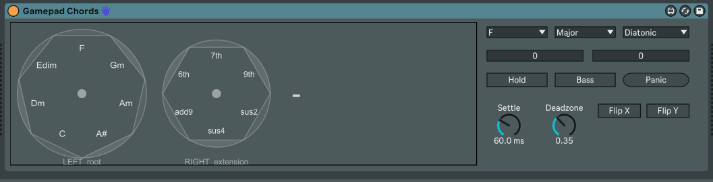

# Gamepad Chords

**Play chords in Ableton Live with a game controller.** Left stick picks the chord, right stick adds colour, and the device shows you what you're playing.



Stuck finding chords that fit? Put the device on a MIDI track in front of any synth, pick a key, and sweep the left stick around the wheel: every chord is already in key. Push the right stick to turn a triad into a 7th, 9th, sus2, sus4, add9 or 6th. It's a fast way to sketch progressions and hear what works, and a playable instrument in its own right.

## Features

- **Diatonic mode:** 7 chords of the chosen key and scale on one stick, so you can't hit a wrong chord. Major or minor, any of the 12 keys.
- **Chromatic mode:** all 12 roots (circle-of-fifths layout, so neighbours are related chords) with a right-stick quality: min, 7, maj7, min7, sus2, sus4, dim, aug.
- **See what you play:** two live wheels with the chord names for your key, a dot for each stick, and the current chord in large text.
- **Plays like an instrument:** right trigger = velocity, left trigger = inversion, buttons for octave, hold, bass note, key, and scale.
- **Settle time:** a short delay stops chords you merely sweep through from sounding.
- **Plain MIDI out:** it's a Max MIDI Effect. Put any instrument after it, or record the notes to a clip.

## What you need

- Ableton Live **Suite** (or Standard with the Max for Live add-on).
- A game controller that Windows/macOS shows as a standard gamepad (Xbox-style and most modern pads). It uses Max's built-in `gamepad` object, so there's no driver or MIDI port to set up.

Developed and tested on **Windows, Live 12 Suite / Max 9** with an Xbox 360-type pad (a Zebronics wired/wireless pair). macOS and other pads should work but are untested: please tell me how it goes.

## Install

1. Download or clone this repo.
2. In Max (open any Max device's editor): **Options > File Preferences**, click **+**, and choose this repo's `src` folder. This lets the device find its two script files.
3. In Live, drag `device/Gamepad Chords.amxd` onto a MIDI track, **before** an instrument.
4. Plug in your pad, move the left stick, and play.

(A single self-contained `.amxd` with the scripts embedded is planned; see the roadmap.)

## Controls

| Control | Action |
|---|---|
| Left stick | Chord root. Straight up = I, then clockwise through the key |
| Right stick | Extension (diatonic) or quality (chromatic) |
| Right trigger | Velocity of the next chord |
| Left trigger | Inversion by depth: light = 1st, more = 2nd, full = 3rd |
| A | Hold: chord keeps ringing after the stick is released |
| B | Bass note (root one octave below) |
| X / Y | Octave down / up |
| D-pad left / right | Key down / up one semitone |
| D-pad up | Next scale (major, minor, dorian, phrygian, lydian, mixolydian, locrian, harmonic minor) |
| D-pad down | Chromatic / diatonic |
| Left bumper | Play style: chord, strum, arpeggio |
| Right bumper | Voice leading on / off |
| Back / Select | Jazz palette on / off (swaps the right-stick set for 6ths, 9ths, 11ths, 13ths, m7b5 and so on) |
| Start | Panic (all notes off) |

Button presses move the dials on the device too. The device also has Key, Scale, Mode, Octave, Inversion, Hold, Bass, Style, Arp pattern, Jazz, Voice lead, Strum, Arp rate, Settle, Deadzone, Flip X, Flip Y and Panic controls. If a bumper or Back does nothing on your pad, use the device buttons and tell me what the print window shows for that button.

## Tips

- **Settle** (default 60 ms) delays a chord change until the stick has stayed on it. Raise it if you hear passing chords between two that are far apart; lower it for snappier playing.
- **Deadzone** (default 0.35) is how far you push before a chord sounds. Raise it if your sticks drift.
- **Strum** rolls the chord out note by note (Strum dial = ms between notes). **Arp** plays one chord tone at a time (Arp rate dial = ms per step; patterns up, down, up/down, random).
- **Voice lead** picks the inversion and octave closest to the previous chord, so progressions move smoothly instead of jumping.
- Diatonic mode with **Hold** on is a quick way to find progressions: tap out chords without having to keep the stick pushed.

## Troubleshooting

| Problem | Fix |
|---|---|
| Nothing happens | Check the pad appears in Windows `joy.cpl` (Win+R). Some pads have a MODE button that switches between standard and other modes |
| Max console says it can't find a `.js` file | Add this repo's `src` folder in Max > Options > File Preferences |
| Wheel is upside-down or mirrored | Toggle **Flip Y** / **Flip X** on the device |
| Chord keeps ringing | Press Panic (or Start). Check Hold (A) isn't on |
| Two pads connected | Both drive the chords; unplug one |

## How it works

`src/gamepad_chords.js` is the engine (loaded by Max's `[js]`). The device wires Max's `[gamepad]` object straight into it. The engine turns each stick's angle into a wheel section, builds the chord, and sends MIDI note-on/off to `[noteout]`. `src/chord_wheel.js` is a `[jsui]` that draws the display. The device is generated by `tools/build_amxd.py`.

More detail: [docs/DEVICE.md](docs/DEVICE.md), [docs/CONTROLLERS.md](docs/CONTROLLERS.md), [docs/MAX_PATCH.md](docs/MAX_PATCH.md) (hand-building the patch).

## Development

```
npm test                  # engine + display tests (node, no Max needed)
python tools/build_amxd.py   # regenerate device/Gamepad Chords.amxd
```

Engine messages (for your own patches): `key`, `scale`, `mode`, `layout`, `octave`, `inversion`, `bass`, `hold`, `deadzone`, `hyst`, `settle`, `vel`, `invx`, `invy`, `panic`, `sync`. See the header of `src/gamepad_chords.js`.

## Roadmap

- Self-contained frozen `.amxd`
- Arpeggio tempo sync to Live's transport and note-length rates
- Chord lock (pin a quality to a degree)
- Slash chords (hold one root while choosing another)
- Chord sets / progressions from a preset list
- Chord memory slots (save and recall progressions)
- Record the played chords to a Live clip
- Per-pad profiles and a calibration step
- macOS testing

## Status

Working on Windows with Live 12 Suite. The engine has automated tests; the device and gamepad handling have been tested by hand on one controller model.

## License

[MIT](LICENSE): free to use, modify and share.
